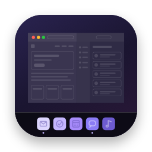
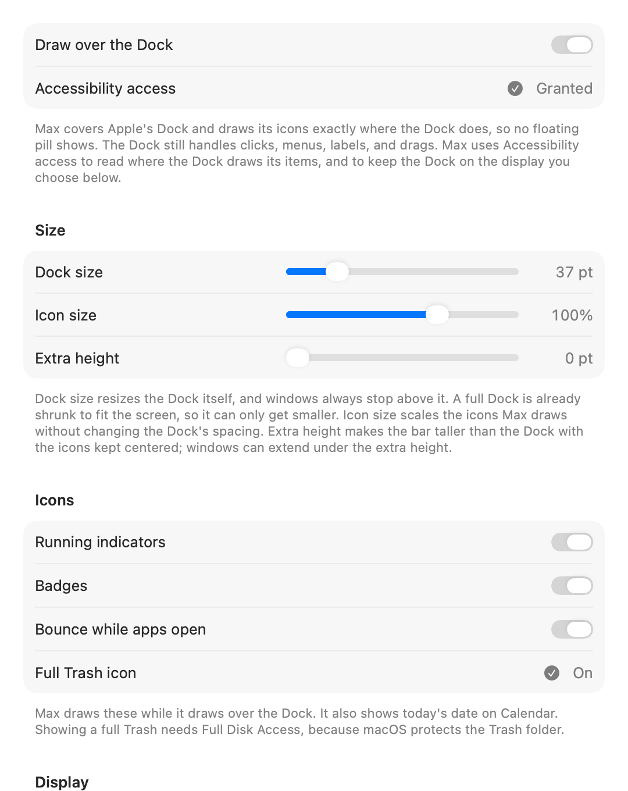
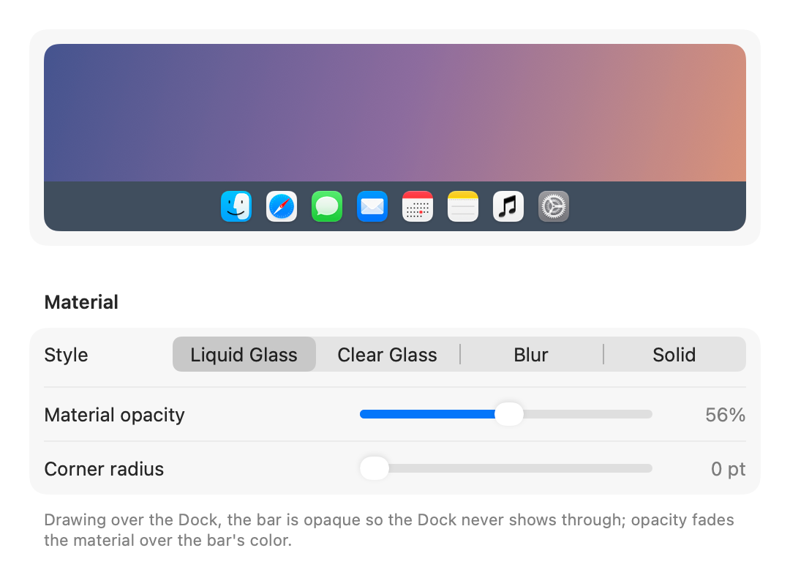
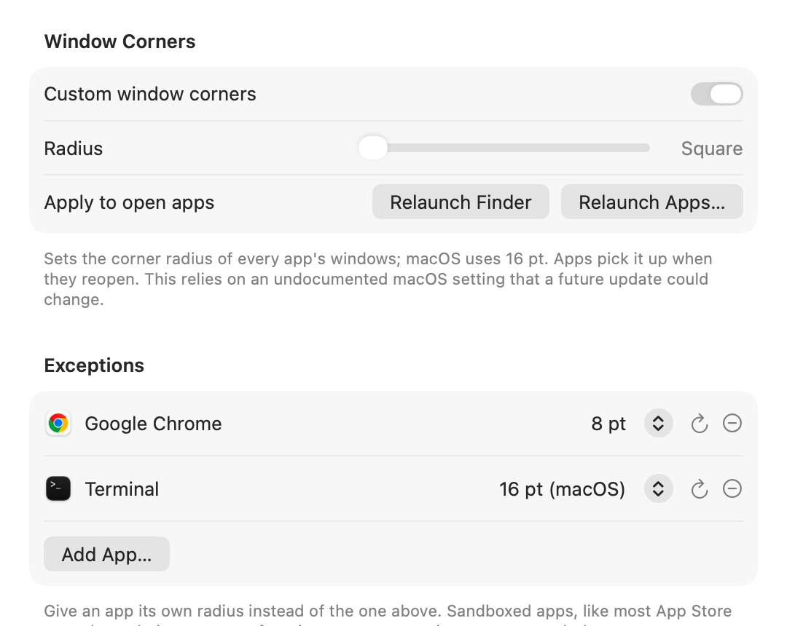

<p align="center"></p>

# Max

A full-width Dock for macOS. Max turns the floating Dock into one bar across the bottom of the screen,
like the Windows taskbar, while Apple's Dock keeps doing all the work underneath: every click, menu,
label, folder stack, and drag still goes to the real Dock.

It also lets you resize and rearrange the Dock, keep it on one display, and square off the corners of
every window.

Requires macOS 26 or later.

<p align="center"></p>

## Features

- **A full-width Dock.** Max covers Apple's Dock with an edge-to-edge bar and draws the Dock's icons,
  running indicators, and badges exactly where the Dock draws them, so no floating pill shows.
- **Still the real Dock.** Clicks, right-click menus, hover labels, folder stacks, and drags all go to
  Apple's Dock. Max follows it as apps launch and quit, items move, and settings change.
- **Live details.** Icons bounce while apps launch, Calendar shows today's date, and the Trash shows
  when it's full. Running dots and badges can each be turned off.
- **Size.** Resize the Dock itself, scale the icons Max draws, or make the bar taller with the icons
  kept centered.
- **Look.** Liquid Glass, Clear Glass, Blur, or Solid, with your own color, opacity, and corner radius.
- **Dock editor and profiles.** Rearrange, add, and remove apps, folders, and spacers, then save. Save
  arrangements as profiles (say, Work and Home) and switch from the menu bar.
- **Keep the Dock on one display.** Stop the Dock from jumping to whichever display you happen to
  push the pointer against.
- **Window corners.** Set the corner radius of every app's windows, down to square, with per-app
  exceptions.
- **Menu bar app.** ⌃⌥⌘M toggles the bar from anywhere; Max can launch at login. Settings come in
  light and dark.

## Install

Download the latest `Max.dmg` from [Releases](https://github.com/jasonschulke/max/releases), open
it, and drag Max to Applications. Or, with Homebrew:

```bash
brew install --cask jasonschulke/tap/max
```

Then open Max from Applications. It lives in the menu bar.

### Permissions

Max asks only for what a feature needs, and works without them (the bar then sits behind the Dock):

| Permission | Used for |
|---|---|
| Accessibility | Reading where the Dock draws its items (to draw over it), and keeping the Dock on one display |
| Full Disk Access (optional) | Showing when the Trash is full; macOS protects the Trash folder |

### Privacy

Max makes no network connections and collects nothing. Its settings stay in
`~/Library/Preferences/jasonschulke.Max.plist`.

## Settings

| Tab | What's there |
|---|---|
| General | Show the bar, launch at login, Settings appearance (System, Light, Dark), animations, the ⌃⌥⌘M shortcut |
| Dock | Draw over the Dock; Dock size, icon size, and extra height; running indicators, badges, launch bounces, and the full Trash; which display the Dock stays on; auto-hide |
| Appearance | A live preview; Liquid Glass, Clear Glass, Blur, or Solid; opacity, corner radius, and color |
| Dock Items | A miniature of the whole Dock above its items. Drag to rearrange, add, remove, and save. Profiles. The first save keeps a backup of your original Dock. |
| Windows | Window corner radius, down to square, with per-app exceptions; relaunch apps to apply |

<p align="center">
  
  
</p>

## Good to know

- **Keep the Dock visible** (auto-hide off). As long as it's on screen, macOS keeps the bottom strip
  free, so maximized and tiled windows stop above the bar.
- **Max relies on undocumented macOS behavior**: how the Dock reports its layout, the window-corner
  preference, and the private call System Settings uses to resize the Dock. A macOS update can change
  any of them. Max checks for each at run time and steps back when one is missing.
- A full Dock is already shrunk to fit the screen, so *Dock size* can only make it smaller.
- Max can't move the Dock to a display itself. Push the pointer against that display's bottom edge
  once, and Max keeps it there.
- Minimized-window thumbnails and apps' own live Dock tiles stay hidden under the bar.
- Window corners apply when apps reopen. Apps that draw their own window frames aren't affected, and
  sandboxed apps (most App Store apps) may not pick up a per-app exception.

## Building from source

With Xcode 26, open `Max.xcodeproj` and run the `Max` scheme. Or with just the Command Line Tools:

```bash
make            # builds build.noindex/Max.app
make test       # runs the model tests
make run        # builds and launches
make install    # copies Max.app to /Applications
```

macOS ties Accessibility access to the app's signature. `Tools/make-signing-identity.sh` creates a
self-signed certificate that `make` uses, so access survives rebuilds.

See [docs/ARCHITECTURE.md](docs/ARCHITECTURE.md) for how Max works, [CONTRIBUTING.md](CONTRIBUTING.md)
to help out, and [RELEASING.md](RELEASING.md) for making a release.

## Credits

Built with help from Claude (Anthropic).

## License

The code is MIT licensed — see [LICENSE](LICENSE).

The Max name and app icon are not covered by that license. Forks and redistributed builds are welcome
under MIT, but please give them a different name and icon so they aren't mistaken for Max.
