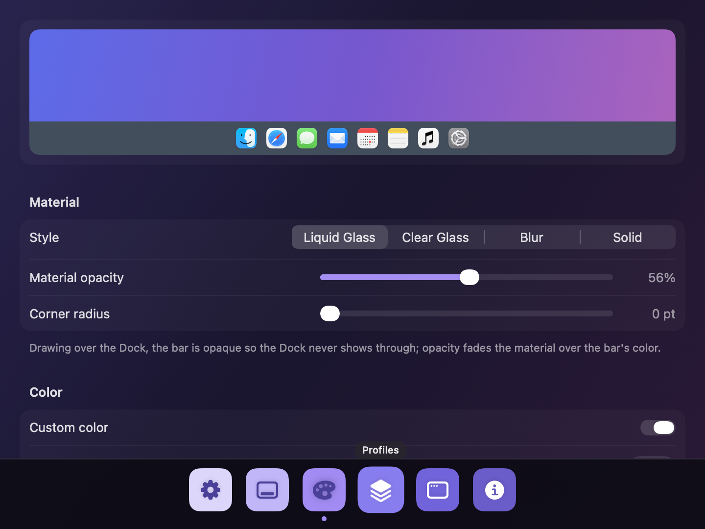
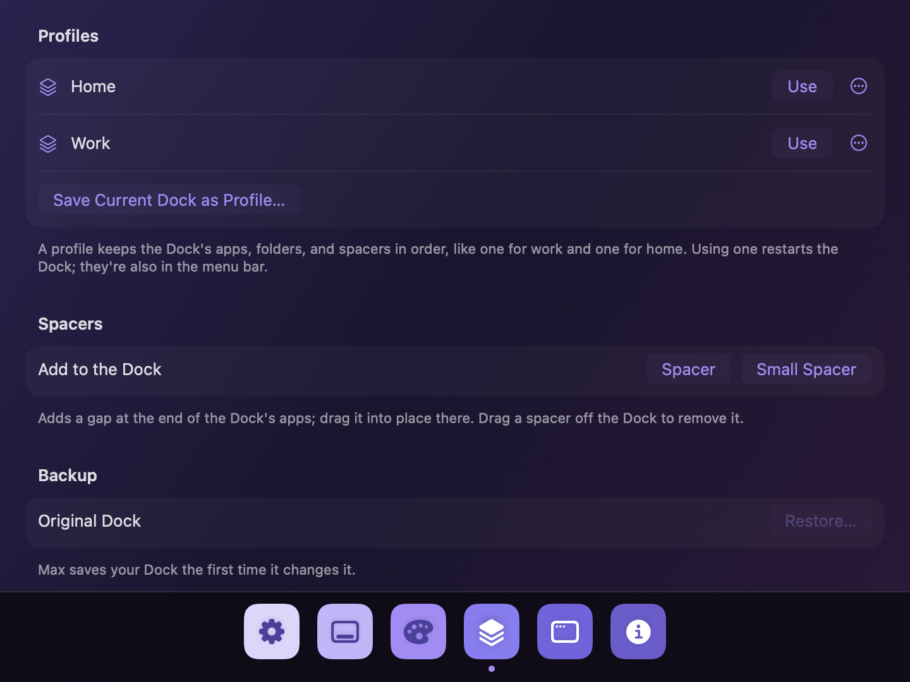

<p align="center"></p>

# Dock Max

A full-width Dock for macOS. Dock Max turns the floating Dock into one bar across the bottom of the screen,
like the Windows taskbar, while Apple's Dock keeps doing all the work underneath: every click, menu,
label, folder stack, and drag still goes to the real Dock.

It also lets you resize and rearrange the Dock, keep it on one display, and square off the corners of
every window.

Requires macOS 26 or later.

<p align="center"></p>

## Features

- **A full-width Dock.** Dock Max covers Apple's Dock with an edge-to-edge bar and draws the Dock's icons,
  running indicators, and badges exactly where the Dock draws them, so no floating pill shows.
- **Still the real Dock.** Clicks, right-click menus, hover labels, folder stacks, and drags all go to
  Apple's Dock. Dock Max follows it as apps launch and quit, items move, and settings change.
- **Live details.** Icons bounce while apps launch, Calendar shows today's date, and the Trash shows
  when it's full. Running dots and badges can each be turned off.
- **Size.** Resize the Dock itself, scale the icons Dock Max draws, or make the bar taller with the icons
  kept centered.
- **Look.** Liquid Glass, Clear Glass, Blur, or Solid, with your own color, opacity, and corner radius.
- **Dock profiles.** Save the Dock's arrangement as a profile (say, Work and Home) and switch from the
  menu bar. Add spacers, and restore your original Dock anytime.
- **Keep the Dock on one display.** Stop the Dock from jumping to whichever display you happen to
  push the pointer against.
- **Window corners.** Set the corner radius of every app's windows, down to square, with per-app
  exceptions.
- **Screen care.** A bar that never moves can leave a ghost on LCDs. Dock Max shifts its icons by a pixel
  every few minutes and can dim the bar while you're away.
- **Menu bar app.** ⌃⌥⌘M toggles the bar from anywhere; Dock Max can launch at login. Settings come in
  light and dark.

## Install

1. Download the latest `DockMax-<version>.dmg` from [Releases](https://github.com/jasonschulke/max/releases),
   open it, and drag Dock Max to Applications.
2. Open Dock Max. The first time, macOS stops it because Dock Max isn't notarized by Apple yet. Click
   **Done**.
3. Open **System Settings → Privacy & Security**, scroll down to **Security**, and click **Open Anyway** next
   to Dock Max (the button shows for about an hour after step 2). Enter your password.

From then on Dock Max opens normally. It lives in the menu bar. Each new version needs steps 2 and 3 once.

### Permissions

Dock Max asks only for what a feature needs, and works without them (the bar then sits behind the Dock):

| Permission | Used for |
|---|---|
| Accessibility | Reading where the Dock draws its items (to draw over it), and keeping the Dock on one display |
| Full Disk Access (optional) | Showing when the Trash is full; macOS protects the Trash folder |

### Privacy

Dock Max makes no network connections and collects nothing. Its settings stay in
`~/Library/Preferences/co.prepwork.dockmax.plist`.

## Settings

Settings has a dock of its own along the bottom: a tile per section (⌘1–⌘6), in light or dark.

| Section | What's there |
|---|---|
| General | Show the bar, launch at login, Settings appearance (System, Light, Dark), animations, the ⌃⌥⌘M shortcut |
| Dock | Draw over the Dock; Dock size, icon size, and extra height; running indicators, badges, launch bounces, and the full Trash; screen care (icon drift, dim when idle); which display the Dock stays on; auto-hide |
| Appearance | A live preview; Liquid Glass, Clear Glass, Blur, or Solid; opacity, corner radius, and color |
| Profiles | Save the Dock as a profile, then use, rename, or delete it; add spacers; restore the original Dock |
| Windows | Window corner radius, down to square, with per-app exceptions; relaunch apps to apply |

Rearranging happens in the Dock itself: drag icons to reorder, off the Dock to remove, or onto it to add.
While you drag, Dock Max steps aside so you can see the Dock's own feedback.

<p align="center">
  
  
</p>
<p align="center"></p>

## Good to know

- **Keep the Dock visible** (auto-hide off). As long as it's on screen, macOS keeps the bottom strip
  free, so maximized and tiled windows stop above the bar.
- **Dock Max relies on undocumented macOS behavior**: how the Dock reports its layout, the window-corner
  preference, and the private call System Settings uses to resize the Dock. A macOS update can change
  any of them. Dock Max checks for each at run time and steps back when one is missing.
- A full Dock is already shrunk to fit the screen, so *Dock size* can only make it smaller.
- Dock Max can't move the Dock to a display itself. Push the pointer against that display's bottom edge
  once, and Dock Max keeps it there.
- Minimized-window thumbnails and apps' own live Dock tiles stay hidden under the bar.
- Window corners apply when apps reopen. Apps that draw their own window frames aren't affected, and
  sandboxed apps (most App Store apps) may not pick up a per-app exception.

## Building from source

With Xcode 26, open `Max.xcodeproj` and run the `Max` scheme. Or with just the Command Line Tools:

```bash
make            # builds "build.noindex/Dock Max.app"
make test       # runs the model tests
make run        # builds and launches
make install    # copies Dock Max.app to /Applications
```

macOS ties Accessibility access to the app's signature. `Tools/make-signing-identity.sh` creates a
self-signed certificate that `make` uses, so access survives rebuilds.

See [docs/ARCHITECTURE.md](docs/ARCHITECTURE.md) for how Dock Max works, [CONTRIBUTING.md](CONTRIBUTING.md)
to help out, and [RELEASING.md](RELEASING.md) for making a release.

## Credits

Built with help from Claude (Anthropic).

## License

The code is MIT licensed — see [LICENSE](LICENSE).

The Dock Max name and app icon are not covered by that license. Forks and redistributed builds are welcome
under MIT, but please give them a different name and icon so they aren't mistaken for Dock Max.
